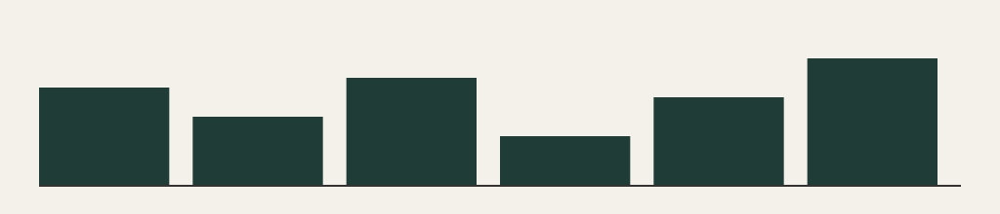

## Beispielthema 8: Balken im zweiten Quartal

Dies ist der erfundene Newsletter Nummer 8. Er steht im Test für einen echten Newsletter und enthält keine wirklichen Angaben zu Märkten, Recht oder Vorsorge.

Ein zweiter Absatz füllt die Seite, damit Archiv, Vorschau und Suche etwas zu zeigen haben. Die Zahl 56 ist frei gewählt.

## Ein zweites Thema

Auch dieser Abschnitt ist ein Platzhalter. Mehr dazu stand im [Newsletter 7](/newsletter-7).

Bei Fragen zu diesem Beispiel hilft die Seite [Kontakt](/kontakt) weiter.
