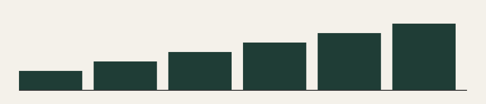

## Beispielthema 9: Balken im dritten Quartal

Dies ist der erfundene Newsletter Nummer 9. Er steht im Test für einen echten Newsletter und enthält keine wirklichen Angaben zu Märkten, Recht oder Vorsorge.

Ein zweiter Absatz füllt die Seite, damit Archiv, Vorschau und Suche etwas zu zeigen haben. Die Zahl 63 ist frei gewählt.

### Ein Zwischentitel

- Erster erfundener Punkt
- Zweiter erfundener Punkt
- Dritter erfundener Punkt

Bei Fragen zu diesem Beispiel hilft die Seite [Kontakt](/kontakt) weiter.
