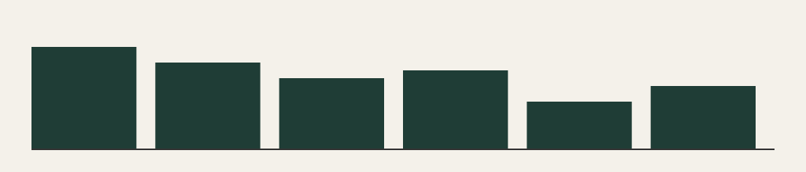

## Beispielthema 10: Balken im vierten Quartal

Dies ist der erfundene Newsletter Nummer 10. Er steht im Test für einen echten Newsletter und enthält keine wirklichen Angaben zu Märkten, Recht oder Vorsorge.

Ein zweiter Absatz füllt die Seite, damit Archiv, Vorschau und Suche etwas zu zeigen haben. Die Zahl 70 ist frei gewählt.

Bei Fragen zu diesem Beispiel hilft die Seite [Kontakt](/kontakt) weiter.
